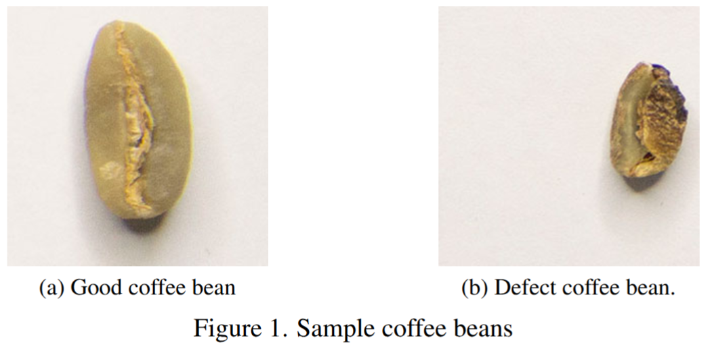
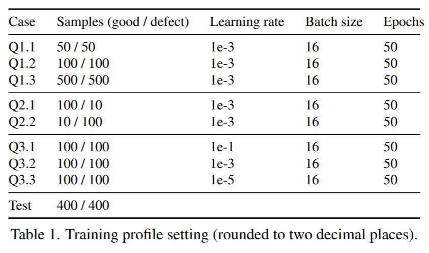
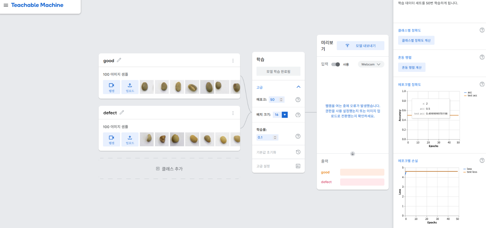
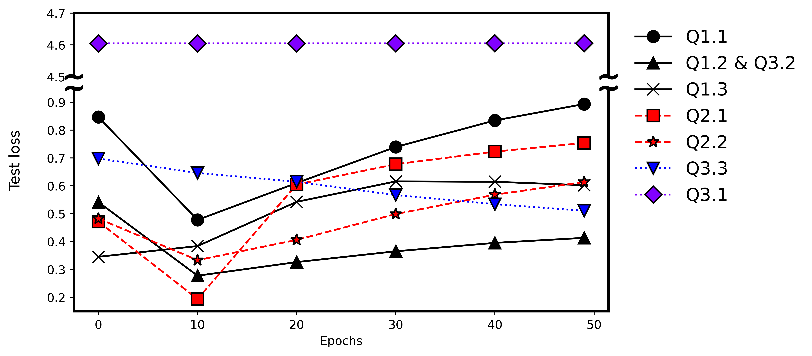

# Potential of Neural Network for Classifying Good and Defective Coffee Bean


## Questions

- Q1. Train size: Impact of train dataset size on test profile

- Q2. Data distribution: Impact of certain label dataset distribution on test profile

- Q3. Learning rate: Impact of learning rate on test profile.

## Data: USK-Coffee (green beans)

- Source: https://coffee.comvislab-usk.org/ .

- premium (good): 1200 (train), 400 (test)

- longberry (good): 1200 (train), 400 (test)

- peaberry (good): 1200 (train), 400 (test)

- defect (good): 1200 (train), 400 (test)

## Dataset Setting


partial construction should be operated manually

## Model & training

With two classes (good and defect), the entire training process was operated by a web-based machine learning platform Google Teachable Machine.



## Reproduce

repository download and conda environment construction
```bash
git clone https://github.com/CheongJea/EF2039_AI_Programming-.git
cd EF2039_AI_Programming-
conda env create -f environment.yml
conda activate pa4
```

To train process on online conditon, plot and test process in following code.

```bash
python code_files/01_plot_testLoss.py
python code_files/02_trainedModelTest.py
```

## Result


